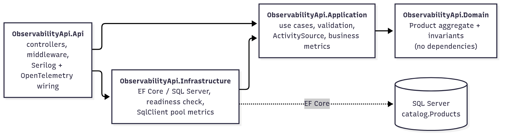
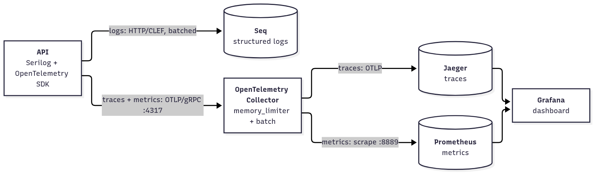

# ObservabilityApi

A small ASP.NET Core Web API (Products CRUD on SQL Server with EF Core) built to show production-grade
observability: **structured logs** (Serilog → Seq), **distributed traces** and **metrics**
(OpenTelemetry → Collector → Jaeger / Prometheus → Grafana).

- [1. Versions and why](#1-versions-and-why)
- [2. Architecture](#2-architecture)
- [3. Folder structure](#3-folder-structure)
- [4. Quick start](#4-quick-start)
- [5. Configuration and secrets](#5-configuration-and-secrets)
- [6. Database and migrations](#6-database-and-migrations)
- [7. Logging (Serilog + Seq)](#7-logging-serilog--seq)
- [8. Tracing (OpenTelemetry + Jaeger)](#8-tracing-opentelemetry--jaeger)
- [9. Metrics (OpenTelemetry + Prometheus + Grafana)](#9-metrics-opentelemetry--prometheus--grafana)
- [10. API behavior, reliability and security](#10-api-behavior-reliability-and-security)
- [11. Tests](#11-tests)
- [12. Manual observability verification guide](#12-manual-observability-verification-guide)
- [13. Production considerations](#13-production-considerations)
- [14. Package installation commands](#14-package-installation-commands)
- [15. Assumptions and limitations](#15-assumptions-and-limitations)

---

## 1. Versions and why

| Component | Version | Reason |
|---|---|---|
| .NET / ASP.NET Core | **10.0** (SDK 10.0.301, runtime image 10.0.12) | Current **LTS** (supported to Nov 2028). .NET 8 LTS support ends Nov 2026, too soon for a new service. |
| EF Core + SQL Server provider | 10.0.12 | Matches the runtime major. EF Core 9+ ships a built-in `Microsoft.EntityFrameworkCore` meter and migration locking. |
| Serilog.AspNetCore | 10.0.0 (Serilog 4.3) | Serilog 4 captures `TraceId`/`SpanId` natively and has built-in, bounded batching. |
| Serilog.Sinks.Seq | 9.1.0 | Current stable. Ships trace/span IDs as `@tr`/`@sp`, so Seq links logs to traces. |
| OpenTelemetry SDK / OTLP exporter | 1.19.1 | Current stable. |
| OTel ASP.NET Core / HttpClient / SqlClient instrumentation | 1.19.0 | All **stable** (SqlClient instrumentation left beta in this line). |
| FluentValidation | 12.1.1 | Current stable. |
| Microsoft.AspNetCore.OpenApi + Scalar.AspNetCore | 10.0.12 / 2.17.10 | Built-in OpenAPI document generation plus an interactive UI. |
| xunit.v3 + Testcontainers.MsSql | 4.0.1 / 4.15.0 | xunit.v3 runs on Microsoft.Testing.Platform (opted in via `global.json`). |

Deliberately **not** used: `OpenTelemetry.Instrumentation.Runtime` (on .NET 9+ it only enables the built-in
`System.Runtime` meter, which is added directly), `OpenTelemetry.Instrumentation.Process` (release candidate
only) and `OpenTelemetry.Instrumentation.EventCounters` (alpha only). See the [metrics section](#9-metrics-opentelemetry--prometheus--grafana)
for how runtime, process and connection-pool metrics are collected without them.

All versions are pinned centrally in [Directory.Packages.props](Directory.Packages.props); container images are pinned in
[docker-compose.yml](docker-compose.yml) and [Dockerfile](Dockerfile).

## 2. Architecture

A modular monolith using pragmatic Clean Architecture. Dependencies point inward.



| Layer | Owns | Must not contain |
|---|---|---|
| Domain | `Product` invariants (SKU format, price range and precision, lengths) | EF, HTTP, logging |
| Application | `ProductService` use cases, FluentValidation validators (reusing domain rules), structured log events, `ActivitySource`, `ProductMetrics` | SQL Server specifics, HTTP |
| Infrastructure | `AppDbContext`, mappings, migrations, SQL error → `ConflictException` translation, retries, readiness check | Business rules |
| Api | HTTP mapping, ProblemDetails, correlation IDs, rate limiting, timeouts, CORS, telemetry pipeline | Business rules |

Deliberate simplifications: no generic repository (`DbSet` already is one; `IAppDbContext` exposes it), no mediator,
and "not found" is a `null` return rather than an exception.

**Telemetry flow**



The diagram sources are in [docs/diagrams/](docs/diagrams/) (`*.mmd`). To regenerate the PNGs after editing:

```bash
docker run --rm -v "$PWD/docs/diagrams:/data" minlag/mermaid-cli -i /data/architecture.mmd -o /data/architecture.png -b white -s 2
docker run --rm -v "$PWD/docs/diagrams:/data" minlag/mermaid-cli -i /data/telemetry-flow.mmd -o /data/telemetry-flow.png -b white -s 2
```

| Tool | Role |
|---|---|
| **Seq** | Structured log search and analysis. Every log event carries `TraceId`/`SpanId`, `CorrelationId`, `Application`, `ApplicationVersion`, `Environment`, `MachineName`. |
| **OpenTelemetry Collector** | A single OTLP endpoint for the app. It batches, limits memory, and routes traces and metrics, so backends can change without redeploying the API. |
| **Jaeger** (v2) | Trace storage and UI: request → application span → SQL spans, with timings. |
| **Prometheus** | Scrapes the Collector's Prometheus exporter and stores metric time series. |
| **Grafana** | Provisioned dashboard (RED, p50/p95/p99, DB, runtime, business) with Prometheus and Jaeger data sources. |

Logs are **not** sent through OpenTelemetry. There is exactly one log pipeline (Serilog → Seq), so no event is exported twice.

## 3. Folder structure

```
ObservabilityApi/
├── ObservabilityApi.slnx
├── global.json                    # SDK pin + Microsoft.Testing.Platform opt-in
├── Directory.Build.props          # net10.0, nullable, analyzers, warnings as errors
├── Directory.Packages.props       # central package versions
├── dotnet-tools.json              # local dotnet-ef 10.0.12
├── Dockerfile                     # targets: final (API), migrator (EF bundle)
├── docker-compose.yml             # api, seq, otel-collector, jaeger, prometheus, grafana (+ optional sqlserver, migrate)
├── .env.example                   # placeholders only; copy to .env (git-ignored)
├── deploy/
│   ├── otel-collector/config.yaml
│   ├── prometheus/prometheus.yml
│   └── grafana/
│       ├── provisioning/datasources/datasources.yaml
│       ├── provisioning/dashboards/dashboards.yaml
│       └── dashboards/observability-api.json
├── http/products.http             # example requests
├── src/
│   ├── ObservabilityApi.Domain/
│   │   ├── DomainException.cs
│   │   └── Products/Product.cs
│   ├── ObservabilityApi.Application/
│   │   ├── Abstractions/IAppDbContext.cs
│   │   ├── Common/{ConflictException,Paging}.cs
│   │   ├── Products/{ProductContracts,ProductLog,ProductService,ProductValidators}.cs
│   │   ├── Telemetry/ApplicationTelemetry.cs      # ActivitySource + ProductMetrics
│   │   └── DependencyInjection.cs
│   ├── ObservabilityApi.Infrastructure/
│   │   ├── Persistence/AppDbContext.cs
│   │   ├── Persistence/Configurations/ProductConfiguration.cs
│   │   ├── Persistence/Migrations/                # InitialCreate
│   │   ├── Health/SqlServerReadinessCheck.cs
│   │   ├── Diagnostics/SqlClientPoolMetrics.cs    # EventCounters -> Meter bridge
│   │   └── DependencyInjection.cs
│   └── ObservabilityApi.Api/
│       ├── Program.cs
│       ├── WebSetup.cs                            # ProblemDetails, rate limiting, timeouts, CORS, pipeline order
│       ├── Controllers/ProductsController.cs
│       ├── Correlation/CorrelationIdMiddleware.cs
│       ├── ErrorHandling/GlobalExceptionHandler.cs
│       ├── Health/HealthEndpoints.cs
│       ├── Observability/{LoggingSetup,TelemetrySetup,ObservabilityOptions}.cs
│       └── appsettings{,.Development,.Production}.json
└── tests/
    ├── ObservabilityApi.UnitTests/        # domain, validators, correlation IDs, statement redaction
    └── ObservabilityApi.IntegrationTests/ # Testcontainers SQL Server + WebApplicationFactory
```

## 4. Quick start

Prerequisites: .NET SDK 10.0.301+, Docker Desktop (or Docker Engine + Compose v2), and a reachable SQL Server
(this repo assumes one on `127.0.0.1,1433`).

All commands run from the `ObservabilityApi/` folder.

### Option A: API on the host, telemetry backends in Docker (best inner loop)

```bash
dotnet tool restore
dotnet user-secrets set "ConnectionStrings:Database" \
  "Server=127.0.0.1,1433;Database=test2;User Id=sa;Password=<password>;TrustServerCertificate=True;" \
  --project src/ObservabilityApi.Api

cp .env.example .env                               # fill in SEQ_ADMIN_PASSWORD, GRAFANA_ADMIN_PASSWORD, DB_CONNECTION_STRING
docker compose up -d seq otel-collector jaeger prometheus grafana

dotnet ef database update --project src/ObservabilityApi.Infrastructure --startup-project src/ObservabilityApi.Api
dotnet run --project src/ObservabilityApi.Api --launch-profile http   # http://localhost:5080
```

### Option B: everything in Docker

```bash
cp .env.example .env                               # DB_CONNECTION_STRING must use host.docker.internal (see below)
docker compose --profile tools run --rm migrate    # one-off migration job
docker compose up -d --build                       # API on http://localhost:8080
```

| URL | What |
|---|---|
| http://localhost:5080 (host) / http://localhost:8080 (Docker) | API. `/scalar` = interactive docs, `/openapi/v1.json` = OpenAPI document |
| http://localhost:8081 | Seq (user `admin`; see the first-login note below) |
| http://localhost:16686 | Jaeger UI |
| http://localhost:9090 | Prometheus |
| http://localhost:3000 | Grafana → Dashboards → *Observability API* (anonymous read-only access locally) |

> **Seq first login:** `SEQ_ADMIN_PASSWORD` is only a *first-run* password, and Seq requires you to change it
> at first sign-in. After that the credential lives in the `seq-data` volume and `.env` is no longer consulted.

## 5. Configuration and secrets

- `appsettings.json` holds safe defaults and **no connection string**. Environment overrides live in
  `appsettings.Development.json` and `appsettings.Production.json`.
- The connection string comes from **user secrets** (Development) or the `ConnectionStrings__Database`
  **environment variable** (Docker and other environments). If it is missing, startup fails with a message that names
  the setting but never prints a value.
- Docker Compose reads secrets from `.env` (git-ignored). `.env.example` contains placeholders only.
- Any setting can be overridden with an environment variable, for example `Observability__Tracing__SamplingRatio=0.2`.

**`localhost` vs Docker hostnames.** `127.0.0.1` works when the API runs on the host. Inside a container,
`127.0.0.1` is the container itself, so the Compose file uses `Server=host.docker.internal,1433` (mapped with
`extra_hosts: host-gateway`, which also works on Linux). If SQL Server runs in the same Compose network, use its service
name (for example `Server=sqlserver,1433` with the optional profile below).

**Optional containerized SQL Server** (for machines without one). It listens on host port **14333** so it does not
clash with an existing server on 1433:

```bash
docker compose --profile local-sql up -d sqlserver
# .env: DB_CONNECTION_STRING=Server=sqlserver,1433;Database=ObservabilityApi;User Id=sa;Password=<LOCAL_SQL_SA_PASSWORD>;TrustServerCertificate=True;
```

Key settings:

| Setting | Default | Notes |
|---|---|---|
| `Observability:Seq:ServerUrl` | empty (disabled); Dev `http://localhost:5341` | Empty turns the sink off. |
| `Observability:Seq:QueueSizeLimit` | 100000 | In-memory buffer bound while Seq is unavailable. |
| `Observability:Seq:BufferBaseFilename` | empty | Set a path to enable durable (disk-buffered) shipping. |
| `Observability:Otlp:Endpoint` | empty (disabled); Dev `http://localhost:4317` | Collector OTLP/gRPC endpoint. |
| `Observability:Tracing:SamplingRatio` | 1.0; Production 0.1 | Parent-based ratio sampler. |
| `Observability:Tracing:CaptureDbStatements` | false | Exports `db.query.text` when true. |
| `Observability:SlowRequestThresholdMs` | 1000; Dev 500 | Slower requests are logged at Warning. |
| `Serilog:MinimumLevel` (+ `Override`) | Information; `Microsoft` = Warning | Per-namespace overrides. |
| `RateLimiting:{Enabled,PermitLimit,WindowSeconds}` | true / 100 / 10 | Fixed window per client IP, per instance. |
| `RequestTimeouts:DefaultTimeoutSeconds` | 30 | Returns 504 ProblemDetails. |
| `Cors:AllowedOrigins` | `[]` | Exact origins only; wildcards are rejected at startup in Production. |
| `OpenApi:Enabled` | true in Development | Maps `/openapi/v1.json` and `/scalar`. |
| `Database:{CommandTimeoutSeconds,MaxRetryCount,MaxRetryDelaySeconds}` | 30 / 5 / 10 | EF Core SQL Server settings. |

## 6. Database and migrations

**Mapping** ([ProductConfiguration.cs](src/ObservabilityApi.Infrastructure/Persistence/Configurations/ProductConfiguration.cs)):
table `catalog.Products` with PK `Id` (EF's sequential GUIDs keep the clustered index append-mostly), `Sku varchar(32)`
with a **unique index**, `Name nvarchar(200)`, `Description nvarchar(2000) NULL`, `Price decimal(18,2)`,
`CreatedAtUtc`/`UpdatedAtUtc datetimeoffset`, and a `RowVersion rowversion` concurrency token. A descending index
`(CreatedAtUtc, Id)` backs the default "newest first" paging order.

All objects, **including the migrations history table** (`catalog.__EFMigrationsHistory`), live in the `catalog`
schema. The shared `test2` database already contains another application's `dbo.__EFMigrationsHistory`; the separate
schema keeps both independent.

Pagination is bounded (`page` 1–1000, `pageSize` 1–100). Deep offsets get slow on large tables; switch to keyset
pagination (`WHERE (CreatedAtUtc, Id) < (@lastCreated, @lastId)`) when that matters.

**Transient retries:** `EnableRetryOnFailure(5 retries, max 10 s delay)`. Retries are logged at Warning and counted by
`microsoft_entityframeworkcore_execution_strategy_operation_failures_total`.

**Commands** (the local tool manifest pins `dotnet-ef` 10.0.12; run `dotnet tool restore` once):

```bash
# create a new migration
dotnet ef migrations add <Name> --project src/ObservabilityApi.Infrastructure \
  --startup-project src/ObservabilityApi.Api --output-dir Persistence/Migrations

# apply to the database from user secrets (dotnet ef runs the host in the Development environment)
dotnet ef database update --project src/ObservabilityApi.Infrastructure --startup-project src/ObservabilityApi.Api

# idempotent SQL script for DBA review or a pipeline
dotnet ef migrations script --idempotent --project src/ObservabilityApi.Infrastructure \
  --startup-project src/ObservabilityApi.Api --output artifacts/migrations/migrate.sql

# self-contained migration executable (what the `migrator` image runs)
docker compose --profile tools run --rm migrate
```

**Production migration strategy:** the API **never** migrates on startup, so N replicas never race to apply the
same migration. Migrations run exactly once per release, as a separate step *before* the new API version rolls out:

1. CI builds the `migrator` image (an EF Core migration bundle) alongside the API image, from the same commit.
2. The deployment pipeline runs it once, as a Kubernetes `Job`, an ECS one-off task, or a pipeline step, using a
   connection string that has DDL rights. The API's own runtime identity only needs DML rights.
3. The API rollout starts only if the job succeeded.

Alternatively, have a DBA apply the reviewed idempotent script. As a safety net, EF Core 9+ takes a database lock
(`sp_getapplock`) while migrating, so an accidental concurrent run waits instead of corrupting the schema. Keep
migrations backward compatible (expand, then contract) so the old and new versions can run side by side during a rolling
deployment.

## 7. Logging (Serilog + Seq)

Implemented in [LoggingSetup.cs](src/ObservabilityApi.Api/Observability/LoggingSetup.cs) and
[CorrelationIdMiddleware.cs](src/ObservabilityApi.Api/Correlation/CorrelationIdMiddleware.cs).

- **Bootstrap logger**: a console logger exists before configuration loads, so startup failures (for example a
  missing connection string) are still logged. It is replaced by the configured logger, not duplicated.
  `Log.CloseAndFlushAsync()` runs in `finally`.
- **Sinks**: Console (readable text; compact JSON in Production for log collectors) and Seq.
- **Levels**: from the `Serilog:MinimumLevel` section, with namespace overrides (`Microsoft` = Warning,
  `Microsoft.Hosting.Lifetime` = Information, EF Core = Warning).
- **Enrichment**: `Application`, `ApplicationVersion` (assembly informational version), `Environment`, `MachineName`,
  `CorrelationId`, plus `TraceId`/`SpanId`. Serilog 4 captures the trace and span IDs natively from `Activity.Current`;
  the Seq sink sends them as `@tr`/`@sp`, and the console template prints them.
- **Structured templates only**. Domain events use source-generated `[LoggerMessage]` methods with stable
  `EventId`s ([ProductLog.cs](src/ObservabilityApi.Application/Products/ProductLog.cs)), for example `ProductCreated` (1001).
- **Request completion logging**: one event per request,
  `HTTP {RequestMethod} {RequestPath} responded {StatusCode} in {Elapsed} ms`, plus `RouteTemplate`. It is logged at
  Error for 5xx, Warning when slower than `SlowRequestThresholdMs`, and Verbose (dropped) for `/health/*`. Query
  strings, headers and bodies are never logged.
- **Correlation ID vs trace ID**: `X-Correlation-ID` is a caller-supplied business or request identifier (it can
  span retries and several traces). It is accepted only if it matches `^[A-Za-z0-9._:-]{1,64}$`; otherwise a new
  dashed GUID is generated, which is visually distinct from a 32-hex trace ID. It is echoed on every response
  (including errors), added to log events, added as a **span attribute** (`correlation.id`, never a metric label),
  and included in ProblemDetails. The W3C trace ID stays owned by OpenTelemetry. Rejected values are never logged.
- **Exceptions are logged once**: [GlobalExceptionHandler](src/ObservabilityApi.Api/ErrorHandling/GlobalExceptionHandler.cs)
  is the only place unexpected exceptions are logged, at Error with the stack trace. EF Core's own
  `CommandError`/`SaveChangesFailed` events are lowered to Debug so a failure is not logged twice. Expected rejections
  (validation, conflict) are logged at Information without stack traces. Request logging sits *outside* the exception
  handler, so it records the final status code, not a second exception.
- **Sensitive data**: no bodies, query strings, headers, connection strings or passwords are logged. Validation
  messages never echo submitted values (a unit test checks this). EF sensitive-data logging stays off. SQL statement
  text is off by default in traces too.

### Buffering, backpressure and delivery

The Seq sink is **asynchronous and bounded**. `ILogger` calls add events to an in-memory queue and return
immediately; a background task posts batches (up to 1,000 events, every 2 s). If Seq is slow or down:

- request threads are **never blocked**; the sink retries with exponential backoff;
- once `QueueSizeLimit` (100,000) events are waiting, **new events are dropped**. The API favors availability over
  complete log delivery;
- on shutdown, one final bounded flush attempt is made. Measured with Seq stopped: the container exited cleanly (code 0)
  in about 4.8 s. `stop_grace_period: 30s` in Compose matches .NET's default host shutdown timeout.

Measured locally with Seq stopped: 20 requests took 12 ms on average (max 33 ms) and `/health/ready` stayed 200. After
Seq restarted, all 20 events logged during the outage appeared in Seq, about 2.5 minutes later because of the retry
backoff.

Trade-offs: the in-memory queue loses buffered events if the process dies during an outage. For stronger delivery,
set `Observability:Seq:BufferBaseFilename` (durable file buffer, which survives restarts at the cost of disk I/O and
local state), or log JSON to stdout and let a node-level agent ship it. Choose **one** of these per environment, never
both, or events are duplicated.

### Example Seq queries

| Question | Seq filter |
|---|---|
| Failed requests (server errors) | `StatusCode >= 500 or @Level = 'Error'` |
| Rejected requests (client errors) | `StatusCode >= 400 and StatusCode < 500` |
| Slow requests | `Elapsed > 500` (or `@Level = 'Warning' and RequestPath like '/api/%'`) |
| Everything for one trace | `@TraceId = '6ec47cc6364e0ec556fcc6269130de87'` |
| Everything for one correlation ID | `CorrelationId = 'demo-create-001'` |
| Product creation events | `EventId.Name = 'ProductCreated'` |
| 404s on the product route | `RouteTemplate = 'api/products/{id:guid}' and StatusCode = 404` |
| Latency summary by route (SQL tab) | `select count(*) as requests, percentile(Elapsed, 95) as p95 from stream where RequestPath like '/api/%' group by RouteTemplate` |

All of these were run against Seq 2026.1 during verification. The last one is a Seq SQL query for the *Data* view;
it returned per-route request counts and p95 in milliseconds.

## 8. Tracing (OpenTelemetry + Jaeger)

Implemented in [TelemetrySetup.cs](src/ObservabilityApi.Api/Observability/TelemetrySetup.cs).

- **Instrumentation**: ASP.NET Core (server spans named by route template), HttpClient, SqlClient (EF Core commands),
  and the custom `ActivitySource` **`ObservabilityApi.Application`**, which creates `CreateProduct`, `GetProduct`,
  `ListProducts`, `UpdateProduct` and `DeleteProduct` spans with `product.id`/`product.sku` attributes.
- **Propagation**: W3C `traceparent`/`tracestate` plus W3C baggage. An incoming `traceparent` is continued (covered by
  an integration test).
- **Export**: OTLP/gRPC → Collector (batched, bounded queue). If the Collector is down, spans are dropped after the
  export timeout and requests are never blocked.
- **Sampling**: `ParentBased(TraceIdRatioBased(SamplingRatio))`, 1.0 in Development and 0.1 in Production. Upstream
  decisions are honored, so traces are never cut in half. Log events keep their `TraceId` even when a trace is not
  sampled, so correlation in Seq still works; Jaeger simply won't hold that trace.
- **Sensitive data**: `OpenTelemetry.Instrumentation.SqlClient` 1.19 always records `db.query.text` and offers no
  option to turn it off, so `DbStatementRedactionProcessor` removes it (and the legacy `db.statement`) before export.
  It keeps the low-cardinality `db.query.summary` (for example `SELECT [catalog].[Products]`). Query **parameter
  values** are off by default in the instrumentation and are never enabled here.
- **Noise control**: `/health/*` requests are not traced. The Seq sink's own HTTP posts are excluded from HttpClient
  tracing, which would otherwise create a root span every 2 s.

**Verified trace** (request `POST /api/products`, correlation `demo-create-001`):

```
6c6bc258c19dbf0d POST api/products               390.5 ms   correlation.id=demo-create-001, http.route=api/products
└─ ed36379053dbf4ce CreateProduct                312.1 ms   product.id=608d9166-..., product.sku=DEMO-569992
   ├─ ce80111c45946d12 SELECT [catalog].[Products]  10.0 ms   db.system.name=microsoft.sql_server, db.namespace=test2 (no db.query.text)
   └─ 9e91e8c7051d3298 INSERT                        9.1 ms
```

Seq showed the same trace ID `6ec47cc6364e0ec556fcc6269130de87` on both related events: the request completion event
(span `6c6bc258…`) and `Product … created` (span `ed363790…`, the application span).

## 9. Metrics (OpenTelemetry + Prometheus + Grafana)

Exported over OTLP to the Collector, exposed by its Prometheus exporter, and scraped with `honor_labels: true`, so
`job="observability-api"` (from `service.name`) and `instance` (from `service.instance.id`, the machine name) are kept.
The names below are the ones **actually present in Prometheus** during verification.

| Area | Prometheus metric(s) | Source |
|---|---|---|
| HTTP count, duration, failures | `http_server_request_duration_seconds_{bucket,count,sum}` (labels `http_request_method`, `http_route`, `http_response_status_code`, `error_type`), `http_server_active_requests` | ASP.NET Core `Microsoft.AspNetCore.Hosting` meter |
| Rate limiting, exceptions, Kestrel | `aspnetcore_rate_limiting_requests_total`, `aspnetcore_diagnostics_exceptions_total`, `kestrel_active_connections` | ASP.NET Core meters |
| Outgoing HTTP | `http_client_request_duration_seconds_*` | `System.Net.Http` meter |
| Runtime and process | `dotnet_process_cpu_time_seconds_total`, `dotnet_process_memory_working_set_bytes`, `dotnet_gc_collections_total`, `dotnet_gc_last_collection_heap_size_bytes`, `dotnet_thread_pool_thread_count_total`, `dotnet_thread_pool_queue_length_total`, `dotnet_exceptions_total` | Built-in `System.Runtime` meter (.NET 9+) |
| DB operation latency | `db_client_operation_duration_seconds_*` (labels `db_query_summary`, `db_operation_name`, …) | OpenTelemetry SqlClient instrumentation |
| DB connection pool | `sqlclient_pool_active_connections`, `…_free_connections`, `…_pooled_connections`, `…_active_hard_connections`, `…_stasis_connections`, `…_active_pools` | **Bridged** from Microsoft.Data.SqlClient 6.1 **EventCounters** by [SqlClientPoolMetrics](src/ObservabilityApi.Infrastructure/Diagnostics/SqlClientPoolMetrics.cs) (meter `ObservabilityApi.SqlClient.Pool`). Process-wide, sampled every 10 s. SqlClient 6.x has no native Meter for these. |
| EF Core | `microsoft_entityframeworkcore_{queries,savechanges,optimistic_concurrency_failures,execution_strategy_operation_failures,compiled_query_cache_hits}_total`, `…_active_dbcontexts` | Built-in `Microsoft.EntityFrameworkCore` meter |
| Business | `products_created_total`, `products_updated_total`, `products_deleted_total` | Custom meter `ObservabilityApi.Products` |

**Label cardinality**: all labels come from bounded sets (method, route **template**, status code, query summary,
GC generation). No user IDs, product IDs, SKUs, trace IDs, correlation IDs or raw URL paths are used as labels;
those belong on spans and log events. Health endpoints use `.DisableHttpMetrics()`, and resource attributes are
exposed once via `target_info` rather than copied onto every series.

### PromQL (used by the dashboard)

```promql
# Request rate (req/s) by route
sum by (http_request_method, http_route) (rate(http_server_request_duration_seconds_count{job="observability-api"}[5m]))

# Error rate: share of 5xx responses ("or vector(0)" keeps it at 0 instead of empty when there are no 5xx series)
(sum(rate(http_server_request_duration_seconds_count{job="observability-api", http_response_status_code=~"5.."}[5m])) or vector(0))
  / sum(rate(http_server_request_duration_seconds_count{job="observability-api"}[5m]))

# Rejected client requests by status (400, 404, 409, 429 ...)
sum by (http_response_status_code) (rate(http_server_request_duration_seconds_count{job="observability-api", http_response_status_code=~"4.."}[5m]))

# Latency p50 / p95 / p99 (seconds)
histogram_quantile(0.50, sum by (le) (rate(http_server_request_duration_seconds_bucket{job="observability-api"}[5m])))
histogram_quantile(0.95, sum by (le) (rate(http_server_request_duration_seconds_bucket{job="observability-api"}[5m])))
histogram_quantile(0.99, sum by (le) (rate(http_server_request_duration_seconds_bucket{job="observability-api"}[5m])))

# p95 per route
histogram_quantile(0.95, sum by (le, http_route) (rate(http_server_request_duration_seconds_bucket{job="observability-api"}[5m])))

# SQL p95 by query shape, pool usage, products created per minute
histogram_quantile(0.95, sum by (le, db_query_summary) (rate(db_client_operation_duration_seconds_bucket{job="observability-api"}[5m])))
sum(sqlclient_pool_active_connections{job="observability-api"})
sum(rate(products_created_total{job="observability-api"}[5m])) * 60
```

During a 60 s local load run these returned about 34 req/s, a 5xx share of 0, p50/p95/p99 of 2.6 / 4.9 / 8.8 ms, and
3,408 rate-limiter rejections, matching the 429s the client received.

**Grafana dashboard** ([observability-api.json](deploy/grafana/dashboards/observability-api.json), provisioned
automatically): request rate, 5xx share, p95 and products-created stats; request rate by route; failed requests by
status; p50/p95/p99; p95 by route; SQL p95; connection pool; EF Core activity; product changes per minute; CPU;
memory; thread pool; GC and exceptions. An `instance` variable filters by replica.

## 10. API behavior, reliability and security

| Endpoint | Success | Errors |
|---|---|---|
| `POST /api/products` | 201 + `Location` | 400 validation, 409 duplicate SKU |
| `GET /api/products/{id}` | 200 | 404 |
| `GET /api/products?page=&pageSize=` | 200 `{items, page, pageSize, totalCount, totalPages}` | 400 out-of-range paging |
| `PUT /api/products/{id}` (body includes `version`) | 200 | 400, 404, 409 stale version |
| `DELETE /api/products/{id}` | 204 | 404 |
| `GET /health/live` | 200 (process up, no dependency checks) | – |
| `GET /health/ready` | 200 when SQL Server responds | 503 |

- **ProblemDetails everywhere** (`application/problem+json`): exceptions, `[ApiController]` model errors, 404s,
  unmatched routes, 405/415, 429 and 504. Each includes `traceId` (plain 32-hex W3C ID) and `correlationId`;
  validation errors add `errors` keyed by camelCase field. A 500 never includes exception messages or stack traces.
- **Readiness** checks SQL Server only, using its own 3 s connection so EF's retry policy cannot stall the probe.
  **Seq and the Collector are deliberately not checked**; this was verified by stopping Seq, after which
  `/health/ready` stayed 200.
- **Rate limiting**: fixed window per client IP (default 100 per 10 s). Rejections get 429 ProblemDetails with
  `Retry-After`. Health and OpenAPI endpoints are exempt. Limits are per instance.
- **Timeouts**: a default 30 s request timeout cancels the request token (and with it in-flight SQL) and returns
  504. Timeouts are not enforced while a debugger is attached.
- **Optimistic concurrency**: `version` (base64 `rowversion`) must match, or the update gets 409 rather than silently
  losing another writer's change.
- **Retries and duplicate effects**: the API adds **no** automatic retries around non-idempotent HTTP operations.
  The only retry is EF Core's transient-fault strategy around `SaveChanges`. It is safe because the insert's key is
  generated client-side *before* the first attempt and the SKU is unique. If a commit succeeded but its acknowledgement
  was lost, the retry hits the PK or unique index and returns **409**, never a second row. A client that retries a
  `POST` after a timeout gets the same guarantee (409 for an already-created SKU), so SKU acts as a natural idempotency
  key. A concurrent-create test fires 5 identical POSTs and asserts exactly one 201.
- **CORS**: only the origins in `Cors:AllowedOrigins`, with explicit methods and headers. It is empty by default in
  Production, and wildcards fail startup there.
- **HTTPS**: the container listens on HTTP 8080 and TLS is expected to terminate at the ingress or load balancer.
  HSTS is on outside Development. Set `Https:RedirectToHttps=true` when Kestrel itself receives HTTPS traffic, and
  set `ASPNETCORE_FORWARDEDHEADERS_ENABLED=true` behind a proxy so scheme and client IP (used by rate limiting) are
  correct.
- **Stateless**: no sessions, in-memory caches or local files (unless durable Seq buffering is enabled), so any number
  of replicas can run behind a load balancer. The container runs as a non-root user.

## 11. Tests

```bash
dotnet test --solution ObservabilityApi.slnx                       # everything (Docker required for integration tests)
dotnet test --project tests/ObservabilityApi.UnitTests             # fast, no Docker
dotnet test --project tests/ObservabilityApi.IntegrationTests
```

Last run: **62 passed, 0 failed** (41 unit, 21 integration). The build has 0 warnings with warnings treated as errors.

- **Unit**: domain rules (SKU normalization and format, price range and precision, lengths, failed update leaves
  state unchanged), validators (every invalid field reported, paging bounds, version format, messages don't echo
  input), correlation ID acceptance and rejection, and SQL statement redaction.
- **Integration**: [ApiFactory](tests/ObservabilityApi.IntegrationTests/Infrastructure/ApiFactory.cs) starts a
  **Testcontainers SQL Server** (`2022-CU23-ubuntu-22.04`, random host port), applies the real migrations to a
  database named `ObservabilityApiTests`, and hosts the API in memory. Tests cover the full CRUD round trip, duplicate
  SKU 409, a concurrent-create race, stale-version 409, paging, 404s, ProblemDetails for validation, malformed JSON,
  unknown routes and unhandled exceptions (no leaked details), correlation ID echo/generation/replacement,
  continuation of an incoming `traceparent`, and liveness and readiness.
- **Never touches `test2`**: the `Testing` environment doesn't load user secrets, the container uses a random port,
  and the factory refuses to run if the database name is `test2`. Seq and OTLP export are disabled in tests.

## 12. Manual observability verification guide

Run from `ObservabilityApi/`. These commands use `curl` (on Windows, `curl.exe` is built in). Each step lists what
was observed during verification.

**1. Start the stack and apply migrations**

```bash
cp .env.example .env   # fill in placeholders
docker compose up -d --build
docker compose --profile tools run --rm migrate
docker compose ps      # api, seq, jaeger, prometheus, grafana: healthy; otel-collector: running
curl -s http://localhost:8080/health/ready
# {"status":"Healthy","totalDurationMs":1.9,"checks":[{"name":"sqlserver","status":"Healthy",...}]}
```

**2. Send successful and failing requests** (or use [http/products.http](http/products.http))

```bash
curl -si -X POST http://localhost:8080/api/products -H "Content-Type: application/json" \
  -H "X-Correlation-ID: demo-create-001" -d '{"sku":"demo-1001","name":"Demo widget","price":12.5}'
curl -si -X POST http://localhost:8080/api/products -H "Content-Type: application/json" \
  -H "X-Correlation-ID: demo-conflict-001" -d '{"sku":"demo-1001","name":"Duplicate","price":1}'   # 409
curl -si -X POST http://localhost:8080/api/products -H "Content-Type: application/json" \
  -H "X-Correlation-ID: demo-invalid-001" -d '{"sku":"!","name":"","price":-1}'                   # 400
curl -si http://localhost:8080/api/products/00000000-0000-0000-0000-000000000001                   # 404
```

A failing response carries both IDs, for example:
`{"title":"The request conflicts with the current state of the resource.","status":409,"detail":"A product with SKU 'DEMO-569992' already exists.","instance":"POST /api/products","traceId":"7e2bbf8a0cfe84be4e223007a0edf5d8","correlationId":"demo-conflict-001"}`

**3. Find the logs in Seq** (http://localhost:8081). Filter `CorrelationId = 'demo-create-001'`: you get the
request completion event and `Product … created with SKU …`, both with the same `TraceId`. Try the other queries in
[section 7](#example-seq-queries).

**4. Follow the trace in Jaeger** (http://localhost:16686). Paste that `TraceId` into *Lookup by Trace ID*, or search
service `observability-api`. Expect `POST api/products` → `CreateProduct` → `SELECT [catalog].[Products]` + `INSERT`,
with no `db.query.text` attribute on the SQL spans. For an error, use the `traceId` from the ProblemDetails body.

**5. Verify metrics.** In Prometheus (http://localhost:9090), run the queries from
[section 9](#promql-used-by-the-dashboard). Generate some load first so `rate()` has data:

```bash
for i in $(seq 1 200); do curl -s -o /dev/null "http://localhost:8080/api/products?page=1&pageSize=5"; done
```

Then open Grafana (http://localhost:3000) → Dashboards → *Observability API* → *Observability API*.

**6. Verify behavior when Seq is unavailable**

```bash
docker compose stop seq
for i in $(seq 1 20); do curl -s -o /dev/null -w "%{http_code} %{time_total}s\n" \
  -H "X-Correlation-ID: seq-outage-$i" "http://localhost:8080/api/products?pageSize=5"; done   # all 200, fast
curl -s http://localhost:8080/health/ready          # still Healthy
docker compose logs api --tail 5                    # console logging continues
docker compose start seq
# Within a few minutes (retry backoff), Seq shows: StartsWith(CorrelationId, 'seq-outage-')  -> 20 events
```

## 13. Production considerations

- **Secrets**: use a secret store (Azure Key Vault, AWS Secrets Manager, Kubernetes secrets with encryption at rest),
  injected as environment variables or a configuration provider. Use separate SQL identities for migrations (DDL) and
  the API (DML only), prefer managed identity or Entra ID authentication over SQL passwords, use `Encrypt=True`
  with a trusted certificate (drop `TrustServerCertificate`), and rotate credentials and the Seq API key.
- **Authentication and authorization**: none is implemented, so the API is open. Add JWT bearer authentication
  (`AddAuthentication().AddJwtBearer()`) with an identity provider, apply authorization policies to the controllers,
  and keep `/health/*` anonymous but not exposed publicly. After adding auth, partition rate limits by user or client
  ID instead of IP. Protect Seq (required API keys for ingestion, SSO for users), Grafana (disable anonymous access)
  and the Collector (network policy or mTLS).
- **Retention**: set it per signal. For example Seq 14–30 days with retention policies (drop Debug early, keep
  Warning/Error longer), traces 3–7 days (Jaeger with Elasticsearch/OpenSearch/Cassandra or Badger storage; the local
  setup is in-memory), and metrics 15–30 days in Prometheus, with long-term storage in Thanos/Mimir if needed.
  Budget storage from measured events/sec, spans/sec and active series.
- **Sampling**: start with 5–10% parent-based head sampling. To keep *all* errors and slow traces, add tail
  sampling in the Collector (`tail_sampling` processor with `status_code` and `latency` policies). That requires
  sending 100% to a Collector tier with trace-ID-aware load balancing (`loadbalancing` exporter).
- **Performance**: log at Information in Production (Debug only through a temporary override), keep Console output
  compact JSON or drop it when Seq is the log pipeline, keep histogram label sets small, raise
  `ExportIntervalMilliseconds` to 30–60 s, and watch `sqlclient_pool_*` against `Max Pool Size` (default 100).
  Consider keyset pagination and a cached or approximate `totalCount` for large tables. Load-test with realistic
  data before setting SLOs.
- **Horizontal scaling**: the API is stateless. Scale replicas behind a load balancer and use `/health/ready` as the
  readiness probe and `/health/live` as liveness. Rate limits are per instance, so use a gateway or distributed
  limiter for global quotas. Run migrations as a one-off job (section 6). Run the Collector as a gateway deployment
  (plus node agents if needed) with the `memory_limiter` and persistent sending queues. Each replica is
  distinguishable by `service.instance.id` (the `instance` label and `MachineName` log property).
- **Images and supply chain**: pin by digest in Production, scan images, consider the `-noble-chiseled` runtime
  image (then remove the Compose bash healthcheck and rely on orchestrator HTTP probes), and generate SBOMs.

## 14. Package installation commands

Versions are centralized, so `dotnet add package` records only the reference (the version comes from
`Directory.Packages.props`). To recreate the references:

```bash
# Application
dotnet add src/ObservabilityApi.Application package Microsoft.EntityFrameworkCore
dotnet add src/ObservabilityApi.Application package FluentValidation
dotnet add src/ObservabilityApi.Application package FluentValidation.DependencyInjectionExtensions
# Infrastructure
dotnet add src/ObservabilityApi.Infrastructure package Microsoft.EntityFrameworkCore.SqlServer
# Api
dotnet add src/ObservabilityApi.Api package Microsoft.AspNetCore.OpenApi
dotnet add src/ObservabilityApi.Api package Scalar.AspNetCore
dotnet add src/ObservabilityApi.Api package Serilog.AspNetCore
dotnet add src/ObservabilityApi.Api package Serilog.Sinks.Seq
dotnet add src/ObservabilityApi.Api package OpenTelemetry.Extensions.Hosting
dotnet add src/ObservabilityApi.Api package OpenTelemetry.Exporter.OpenTelemetryProtocol
dotnet add src/ObservabilityApi.Api package OpenTelemetry.Instrumentation.AspNetCore
dotnet add src/ObservabilityApi.Api package OpenTelemetry.Instrumentation.Http
dotnet add src/ObservabilityApi.Api package OpenTelemetry.Instrumentation.SqlClient
dotnet add src/ObservabilityApi.Api package Microsoft.EntityFrameworkCore.Design
# Tests
dotnet add tests/ObservabilityApi.UnitTests package xunit.v3
dotnet add tests/ObservabilityApi.IntegrationTests package xunit.v3
dotnet add tests/ObservabilityApi.IntegrationTests package Microsoft.AspNetCore.Mvc.Testing
dotnet add tests/ObservabilityApi.IntegrationTests package Testcontainers.MsSql
# Tools
dotnet new tool-manifest && dotnet tool install dotnet-ef --version 10.0.12
```

### Container images and licensing

| Image | Tag | Auth / licensing |
|---|---|---|
| `mcr.microsoft.com/dotnet/sdk`, `aspnet` | 10.0.301 / 10.0.12 | MIT. |
| `datalust/seq` | 2026.1.17182 | `ACCEPT_EULA=Y` is required. Seq is free for individual use under its *Individual* license; teams and production need a paid license (see datalust.co/pricing). The first-run admin password must be changed at first login. |
| `otel/opentelemetry-collector-contrib` | 0.161.0 | Apache 2.0. The `otlp` exporter name is deprecated in this version; the config uses `otlp_grpc`. |
| `jaegertracing/jaeger` | 2.21.0 | Apache 2.0. The local config uses in-memory storage, so traces are lost on restart. |
| `prom/prometheus` | v3.5.5 (LTS line) | Apache 2.0. |
| `grafana/grafana` | 12.4.11 | AGPLv3 (OSS). Admin credentials come from `.env`; anonymous Viewer access is enabled locally only. |
| `mcr.microsoft.com/mssql/server` (optional profile and tests) | 2022-CU23-ubuntu-22.04 | `ACCEPT_EULA=Y`; `MSSQL_PID=Developer` is free for development and test only, not production. |

## 15. Assumptions and limitations

- The local SQL Server is reachable at `127.0.0.1,1433` (in this environment it's a SQL Server 2022 CU23 container),
  and applying the migration to `test2` is acceptable. It only **adds** the `catalog` schema and its tables.
- The API has no authentication yet (see section 13).
- The HttpClient instrumentation is registered, but the API makes no outbound calls of its own yet. Only the Seq
  sink uses HttpClient, and it is deliberately excluded from tracing. Outbound calls from future typed clients will be
  traced automatically.
- Connection-pool metrics come from SqlClient EventCounters through a small in-house bridge, because no stable
  OpenTelemetry package or native SqlClient Meter provides them for SqlClient 6.1.
- Not verified here: the optional `local-sql` Compose profile (its image is the same one the tests ran; the profile
  itself was not started), running on Linux or macOS hosts, durable Seq buffering, the 504 request-timeout path, and
  production-scale load.
